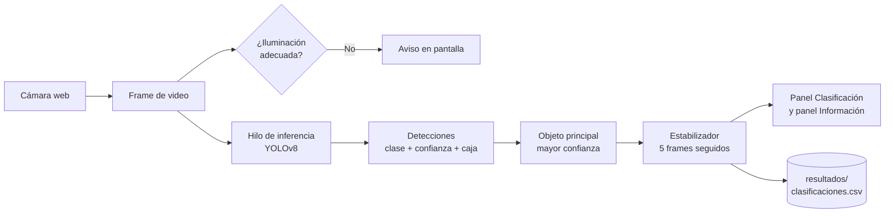

# Sistema de Reciclaje Inteligente

Aplicación de escritorio que **clasifica residuos en tiempo real** con una cámara web y un modelo de detección de objetos **YOLOv8**, y le indica al usuario en qué contenedor depositarlos según la **NTP 900.058:2019**.

Proyecto de tesis — Universidad César Vallejo.

## Cómo funciona



1. La cámara captura el video y se muestra en el panel central.
2. Un **hilo en segundo plano** ejecuta el modelo sobre el frame más reciente, para que la ventana no se congele aunque el modelo sea lento en CPU.
3. Se descartan detecciones con menos de **50 % de confianza** y se elige el objeto principal.
4. Para evitar parpadeos, la categoría solo se muestra cuando se repite en **5 frames seguidos**.
5. La app muestra la tarjeta de la categoría (izquierda), la información de reciclaje (derecha) y dibuja el recuadro sobre el objeto.
6. Cada clasificación confirmada se guarda en `resultados/clasificaciones.csv` como evidencia para el análisis.

## Categorías

| Clase del modelo | Categoría | Contenedor (NTP 900.058:2019) |
|---|---|---|
| Metal | Metales | Amarillo |
| Vidrio | Vidrio | Plomo |
| Plastico | Plástico | Blanco |
| Papel_Carton | Papel y cartón | Azul |
| Organico | Orgánico | Marrón |

El modelo (YOLOv8s) se entrenó con el *Trash Detection Dataset* (Kan, 2025; CC BY 4.0). Ficha técnica, dataset y métricas completas en [`docs/MODELO.md`](docs/MODELO.md).

### Resultados en el conjunto de prueba

| Clase | Precisión | Recall | mAP50 |
|---|---|---|---|
| Metal | 0.752 | 0.594 | 0.615 |
| Vidrio | 0.798 | 0.304 | 0.328 |
| Plástico | 0.494 | 0.494 | 0.490 |
| Papel y cartón | 0.643 | 0.507 | 0.561 |
| Orgánico | 0.808 | 0.478 | 0.600 |
| **Todas** | **0.699** | **0.475** | **0.519** |

## Requisitos

- Windows 10/11, Linux o macOS
- **Python 3.10, 3.11 o 3.12**
- Cámara web
- Opcional: GPU NVIDIA con CUDA (acelera mucho la detección)

## Instalación

```bash
python -m venv .venv
.venv\Scripts\activate          # Windows
# source .venv/bin/activate     # Linux / macOS
pip install -r requirements.txt
```

Para usar una GPU NVIDIA (recomendado: pasa de ~0.8 s a ~18 ms por imagen), instale además PyTorch con CUDA:

```bash
pip install --force-reinstall --no-deps torch torchvision --index-url https://download.pytorch.org/whl/cu128
```

## Uso

```bash
python main.py
```

- Muestra la pantalla de bienvenida mientras carga el modelo y luego abre la cámara.
- Coloque el residuo frente a la cámara con buena iluminación.
- **Esc** o cerrar la ventana termina la aplicación y libera la cámara.

La app busca sola la primera cámara que entregue imagen (índices 0 a 4), porque con cámaras virtuales instaladas la cámara física no siempre es la 0. Los parámetros (confianza mínima, frames de estabilidad, umbrales de brillo, índice fijo de cámara) están en [`reciclaje/config.py`](reciclaje/config.py).

## Estructura del proyecto

```
pythonProject/
├── main.py                       Punto de entrada
├── reciclaje/
│   ├── config.py                 Rutas, umbrales, categorías y posiciones de la interfaz
│   ├── deteccion.py              Lógica pura: clases, objeto principal, iluminación, estabilizador
│   ├── registro.py               Registro CSV de clasificaciones
│   └── app.py                    Interfaz Tkinter y hilo de inferencia
├── modelos/best.pt               Modelo YOLOv8 entrenado
├── setUp/                        Fondos y tarjetas de cada categoría
├── entrenamiento/
│   ├── dataset.yaml              Configuración del dataset (formato YOLO)
│   ├── entrenar.py               Entrenamiento / reentrenamiento
│   ├── evaluar.py                Métricas: precisión, recall, mAP, matriz de confusión
│   ├── analizar_registro.py      Resumen de las clasificaciones en uso real
│   └── evaluar_pruebas_campo.py  Resultados de las pruebas con objetos reales
├── pruebas_campo/                Protocolo y formato de pruebas con objetos reales
├── tests/                        Pruebas automatizadas (pytest)
└── docs/
    ├── MODELO.md                 Ficha técnica: dataset, entrenamiento y métricas
    └── resultados/               Matriz de confusión, curvas y métricas para la tesis
```

## Pruebas

```bash
pip install -r requirements-dev.txt
pytest
```

Las pruebas verifican la traducción de clases del modelo, la elección del objeto principal, los avisos de iluminación, el estabilizador, el registro CSV, que existan todas las imágenes de la interfaz y que el modelo real cargue y prediga.

## Entrenamiento

Así se generó el modelo actual:

1. Descargue el [Trash Detection Dataset](https://doi.org/10.17632/z732f9pwxt.1) y descomprímalo en `datos_crudos/`.
2. Prepárelo con las 5 categorías (reagrupa clases y convierte polígonos a cajas):
   ```bash
   python entrenamiento/preparar_dataset.py
   ```
3. Entrene (GPU):
   ```bash
   python entrenamiento/entrenar.py --modelo yolov8s.pt --epocas 60 --lote 16 --paciencia 15 --dispositivo 0 --nombre reciclaje_v2
   ```
4. Copie `runs/detect/reciclaje_v2/weights/best.pt` a `modelos/best.pt`.

## Evaluación (resultados de la tesis)

```bash
python entrenamiento/evaluar.py --split test
```

Genera en `resultados/evaluacion/` la tabla de **precisión, recall, mAP50 y mAP50-95** por clase (`metricas.md`, lista para el documento), la **matriz de confusión** y las curvas PR y F1.

Para resumir el uso real de la app:

```bash
python entrenamiento/analizar_registro.py
```

## Pruebas con objetos reales

Siga [`pruebas_campo/protocolo.md`](pruebas_campo/protocolo.md), registre cada prueba en `pruebas_campo/formato_pruebas.csv` y calcule los resultados:

```bash
python entrenamiento/evaluar_pruebas_campo.py
```

Obtiene exactitud global, precisión, recall y F1 por clase, matriz de confusión y exactitud por condición de iluminación.

## Limitaciones conocidas

- **Vidrio** es la clase más difícil (recall 0.30 en prueba): por su transparencia, a veces no se detecta o se confunde con plástico.
- Sin GPU la detección se actualiza ~1 vez por segundo; con GPU es en tiempo real.
- La precisión depende de la iluminación y del fondo; la app avisa cuando hay poca o demasiada luz.

## Autor

**Angel Castañeda Meza** — Ingeniería de Sistemas, Universidad César Vallejo.
